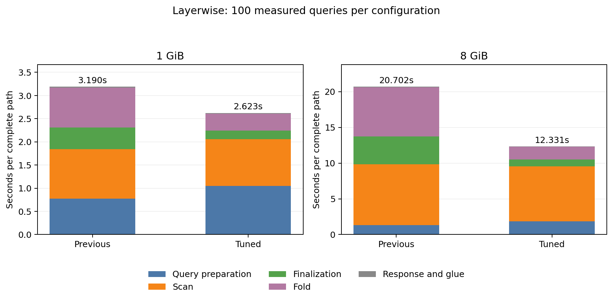

# Layerwise tuning across database scales

Each configuration completed 100 correct complete-path queries after 3 warmups. Selection minimized measured mean server time.

| Scale | Previous mean s | Tuned mean s | Time reduction | Speedup |
| --- | ---: | ---: | ---: | ---: |
| 1 GiB | 3.190 | 2.623 | 17.776% | 1.216x |
| 8 GiB | 20.702 | 12.331 | 40.434% | 1.679x |

## Stage means

| Scale | Stage group | Previous ms | Tuned ms |
| --- | --- | ---: | ---: |
| 1 GiB | Query preparation | 772.554 | 1049.239 |
| 1 GiB | Scan | 1072.265 | 1004.138 |
| 1 GiB | Finalization | 464.790 | 186.620 |
| 1 GiB | Fold | 861.916 | 368.820 |
| 1 GiB | Response and glue | 18.694 | 14.298 |
| 8 GiB | Query preparation | 1320.669 | 1851.438 |
| 8 GiB | Scan | 8517.114 | 7715.641 |
| 8 GiB | Finalization | 3895.062 | 963.797 |
| 8 GiB | Fold | 6900.359 | 1770.342 |
| 8 GiB | Response and glue | 68.918 | 30.106 |

## Communication

Online byte counts are unchanged by tuning at each scale. Key estimates are one-time setup costs.

| Scale | Modeled query bytes | Actual response bytes | Modeled helper-key bytes |
| --- | ---: | ---: | ---: |
| 1 GiB | 267840 | 206784 | 1488000 |
| 8 GiB | 312480 | 240576 | 1488000 |

## Measurement scope

All runs used the same CloudLab host, CPU 0 and interleaved NUMA memory. Previous and tuned measurements were separate processes; speedups are descriptive ratios of measured arithmetic means. The two panels use separate vertical scales. Response and glue includes modulus switching and the residual between the full server timer and named stages.

