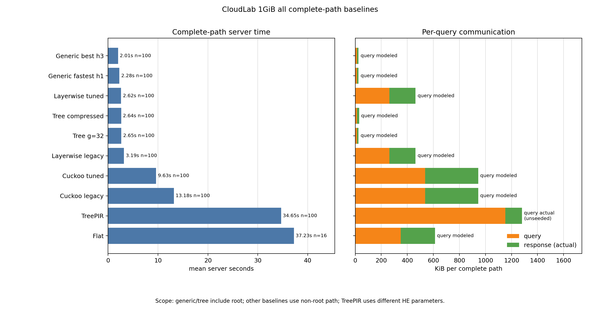

# CloudLab 1GiB All Baselines Comparison

Fastest ranked complete-path configuration: Generic best h3 at 2010.239 ms mean server time over 100 samples.
Generic best h3 versus fastest h1: speedup 1.134434, paired 95% CI 1.134046..1.134827, time reduction 11.85035%.

## Main Table

| rank | scheme | samples | mean ms | median ms | p95 ms | sample SD ms | query bytes | response bytes | config note |
| --- | --- | --- | --- | --- | --- | --- | --- | --- | --- |
| 1 | Generic best h3 | 100 | 2010.239 | 2010.257 | 2015.120 | 2.678 | 14880 modeled | 11264 actual | h=3 G=64 P=1 N0=352 b=9 |
| 2 | Generic fastest h1 | 100 | 2280.484 | 2280.510 | 2285.160 | 2.864 | 14880 modeled | 11264 actual | h=1 G=8 P=3 N0=512 b=7 |
| 3 | Layerwise tuned | 100 | 2623.115 | 2622.587 | 2629.962 | 7.952 | 267840 modeled | 206784 actual | profiled |
| 4 | Tree compressed | 100 | 2635.122 | 2639.261 | 2661.812 | 19.712 | 14880 modeled | 16632 actual |  |
| 5 | Tree g=32 | 100 | 2647.043 | 2649.660 | 2667.862 | 15.032 | 14880 modeled | 11264 actual |  |
| 6 | Layerwise legacy | 100 | 3190.220 | 3190.305 | 3199.089 | 6.004 | 267840 modeled | 206784 actual | legacy |
| 7 | Cuckoo tuned | 100 | 9629.532 | 9638.982 | 9647.065 | 17.130 | 550560 modeled | 416768 actual | 37 buckets, +1-bucket variant, h_q=9 N0=256 |
| 8 | Cuckoo legacy | 100 | 13181.796 | 13147.030 | 13371.376 | 82.839 | 550560 modeled | 416768 actual | 37 buckets, +1-bucket variant |
| 9 | TreePIR | 100 | 34653.341 | 34725.067 | 34749.940 | 116.116 | 1179987 actual unseeded | 131185 actual | SEAL BFV N=8192, coeff bits 42/58/58/60, plain bits 28 |
| 10 | Flat | 16 | 37225.532 | 37207.960 | 37449.026 | 107.755 | 357120 modeled | 270336 actual |  |
| ref | Standard OnionPIR | 100 | 1544.023 | 1544.175 | 1549.183 | 3.639 | 14880 modeled | 11264 actual |  |
| ref | Tree g=1 12-bit diagnostic | 100 | 407.035 | 406.949 | 408.594 | 0.991 | 14880 modeled | 11264 actual |  |

## Per-Query Communication

The figure reports query and actual response bytes per complete path. Query bytes are modeled except TreePIR, where the actual unseeded query payload is used. Helper/eval keys are setup material and appear only in the helper-key table.

## Helper / Eval Keys

| scheme | helper/eval key bytes | extra compression key bytes | total setup bytes | helper/eval basis | human total |
| --- | --- | --- | --- | --- | --- |
| Generic best h3 | 1607040 | — | 1607040 | modeled | 1.53 MiB |
| Generic fastest h1 | 1607040 | — | 1607040 | modeled | 1.53 MiB |
| Layerwise tuned | 1488000 | — | 1488000 | modeled | 1.42 MiB |
| Tree compressed | 1607040 | 65560 modeled | 1672600 | modeled | 1.60 MiB |
| Tree g=32 | 1607040 | 0 modeled | 1607040 | modeled | 1.53 MiB |
| Layerwise legacy | 1488000 | — | 1488000 | modeled | 1.42 MiB |
| Cuckoo tuned | 1488000 | — | 1488000 | modeled | 1.42 MiB |
| Cuckoo legacy | 1130880 | — | 1130880 | modeled | 1.08 MiB |
| TreePIR | 39395731 | — | 39395731 | actual uncompressed | 37.57 MiB |
| Flat | 1488000 | — | 1488000 | modeled | 1.42 MiB |
| Standard OnionPIR | 1488000 | — | 1488000 | modeled | 1.42 MiB |
| Tree g=1 12-bit diagnostic | 1607040 | 0 modeled | 1607040 | modeled | 1.53 MiB |

The compressed-tree prototype also has a 65,560 B once-only modeled compression key, so its total modeled setup is 1,672,600 B. Cuckoo legacy and tuned have the same online query/response bytes in this run, but setup keys differ: legacy is 1,130,880 B and tuned is 1,488,000 B, an increase of 357,120 B from the reference-parameter alignment.

## Storage

| scheme | DB bytes | human DB | estimated steady-state bytes | human steady-state |
| --- | --- | --- | --- | --- |
| Generic best h3 | 5905694720 | 5.50 GiB | 6019943216 | 5.61 GiB |
| Generic fastest h1 | 6442795008 | 6.00 GiB | 6587715456 | 6.14 GiB |
| Layerwise tuned | 5741711296 | 5.35 GiB |  |  |
| Layerwise legacy | 5732405184 | 5.34 GiB |  |  |
| Cuckoo tuned | 16760438784 | 15.61 GiB |  |  |
| Cuckoo legacy | 16737370112 | 15.59 GiB |  |  |
| Flat | 5729419264 | 5.34 GiB |  |  |
| Standard OnionPIR | 5729419264 | 5.34 GiB |  |  |

## Scope And Limits

Results are configuration measurements for the recorded CloudLab 1GiB run. Generic super-record rows retrieve the full ancestor path including the root; the non-root baselines follow their recorded benchmark configurations. TreePIR uses different SEAL BFV parameters from the OnionPIRv2-family rows, listed in its config note. These measurements support this configuration comparison, not a universal algorithmic speedup claim.

No bootstrap was rerun for this report. The only CI shown is read from `generic-analysis.json`; all other comparisons are descriptive.
