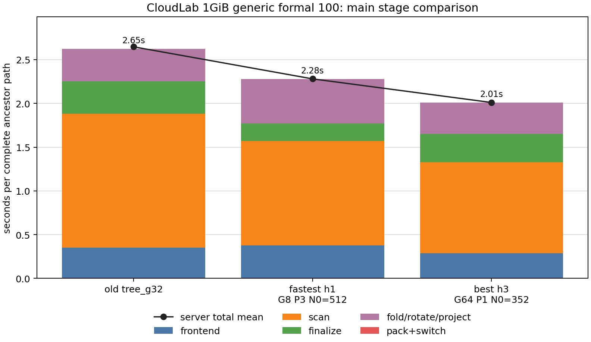

# CloudLab 1GiB Generic Super-Record Formal 100 Comparison

Scope: completed CloudLab 1GiB generic super-record formal run, with old `tree_g32` as a separate-process descriptive reference.

Primary result: `bundle3` is the fastest eligible generic candidate with mean server time 2010.239 ms. Its shape is h3, G=64, P=1, N0=352, beta_bits=9.

Compared with the fastest measured h1 candidate (`generic-h1-mandatory-1`, mean 2280.484 ms), `bundle3` has paired speedup 1.134434 with 95% paired-block bootstrap CI 1.134046..1.134827; mean server time is lower by 11.85035%.

The old `tree_g32` run is a separate-process descriptive reference: mean 2647.043 ms, descriptive speedup 1.31678 for `bundle3`, and descriptive time reduction 24.0572%.

## Seven Generic Candidates

| candidate | h | G | P | N0 | beta bits | mean ms | median ms | p95 ms | sample SD ms | m32 DB bytes | estimated steady state |
| --- | --- | --- | --- | --- | --- | --- | --- | --- | --- | --- | --- |
| bundle3 | 3 | 64 | 1 | 352 | 9 | 2010.239 | 2010.257 | 2015.120 | 2.678 | 5.50 GiB | 5.61 GiB |
| frontier-1 | 3 | 32 | 2 | 352 | 8 | 2073.534 | 2073.094 | 2079.393 | 2.681 | 5.50 GiB | 5.61 GiB |
| frontier-2 | 3 | 64 | 1 | 342 | 9 | 2190.869 | 2190.433 | 2195.865 | 3.201 | 5.34 GiB | 5.45 GiB |
| generic-h1-mandatory-1 | 1 | 8 | 3 | 512 | 7 | 2280.484 | 2280.510 | 2285.160 | 2.864 | 6.00 GiB | 6.14 GiB |
| generic-h1-frontier-1 | 1 | 32 | 1 | 512 | 9 | 2600.132 | 2599.663 | 2608.257 | 4.119 | 8.00 GiB | 8.14 GiB |
| generic-h1-frontier-2 | 1 | 16 | 2 | 512 | 8 | 2699.904 | 2700.287 | 2707.540 | 5.037 | 8.00 GiB | 8.14 GiB |
| bundle3-variant-2 | 3 | 64 | 1 | 171 | 10 | 3564.439 | 3564.235 | 3571.434 | 3.440 | 5.34 GiB | 5.43 GiB |

## Main Stage Comparison

Values are mean milliseconds per complete ancestor path for old `tree_g32`, fastest h1, and best h3.

| case | frontend ms | scan ms | finalize ms | fold/rotate/project ms | pack+switch ms |
| --- | --- | --- | --- | --- | --- |
| old tree_g32 | 350.205 | 1531.762 | 369.643 | 372.439 | 0.791 |
| fastest h1 | 377.623 | 1191.844 | 201.371 | 507.494 | 1.160 |
| best h3 bundle3 | 288.102 | 1038.458 | 322.937 | 359.234 | 0.800 |

## Communication And Memory

| scope | query upload | response download | once modeled eval keys | note |
| --- | --- | --- | --- | --- |
| generic candidates | 14880 modeled | 11264 actual | 1607040 B | same for all 7 candidates |
| old tree_g32 | 14880 modeled | 11264 actual | 1607040 B | same online query/response/eval-key byte counts |

The generic run held all 7 candidate databases in one process; process peak RSS was 51339575296 B (47.81 GiB). The best candidate m32 DB count is 5905694720 B (5.50 GiB); its estimated steady state is 6019943216 B (5.61 GiB).

## Gates And Sources

All 7 eligible candidates have 100 measured samples, target noise gates passed, configured `min_noise_margin` 1, and observed minimum margin 1.

Generic raw source commit: `22adeee2d9e5caa95fa6d38a4d5b152fc0a8772e`. Later FB changes modified codec/fixture preprocessing and baseline selection. The generic online kernel did not change under that note.

Paired generic comparison source: `generic-analysis.json`, 10000 resamples, 100 paired blocks, estimator `ratio of arithmetic means; percentile paired-block bootstrap`.

## Limitations

`tree_g32.json` is a separate-process reference, so its speedup is descriptive and has no paired CI. The process peak RSS is a run-level measurement for all 7 resident generic candidate databases. The formal 100-result set here is the generic run only; the current formal tuned Layerwise and Cuckoo runs are still separate work.
